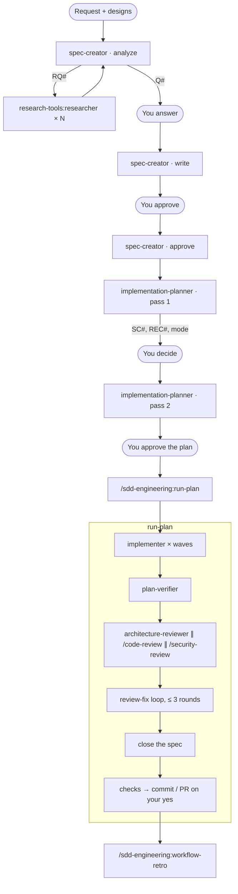

# sdd-engineering

Spec-Driven Development (SDD) for Claude Code, set up for **Angular** frontends and **NestJS** APIs. A feature goes from a request to a merged change through written, checkable artifacts:

1. A **spec** says what the system must do and how to check it: EARS acceptance criteria, edge cases, non-functional requirements.
2. A **plan** says how to build it: steps, files, skills, tests, and work packages that parallel implementers can own.
3. **Implementers** execute the plan, then a **verifier** checks the result against the spec and the plan, row by row.
4. **Reviewers** look for architecture and correctness problems; a bounded loop fixes what they find.
5. A **retro** measures the run and proposes improvements to the prompts and the flow.

Every hand-off is a file, so a run survives a fresh chat, and every claim of "done" has evidence behind it.

## Install

```bash
claude plugin install sdd-engineering --marketplace sgdiachenko/gm-ai-marketplace-angular-nestjs
```

Or in a session: `/plugin install sdd-engineering --marketplace sgdiachenko/gm-ai-marketplace-angular-nestjs`. The repository is private: see the marketplace's `docs/installing.md` for git access. Claude Code installs the three plugins it depends on:

| Dependency | Gives the workflow |
|---|---|
| `engineering-paved-path` `^2.0.0` | the practice skills agents apply: the official `angular-developer`, NestJS practices, Angular and NestJS architecture, security, `INSIGHTS.md` |
| `research-tools` `^1.0.0` | `researcher`, which answers the spec writer's research requests with evidence |
| `architecture-review` `^2.0.0` | `architecture-reviewer`, the layering review in `/run-plan` |

## The flow



The main session — your chat — orchestrates. Subagents can't ask you questions, so each returns numbered questions (`Q#`), research requests (`RQ#`) or recommendations (`REC#`), and the main session asks you and re-invokes the agent with your answers. Nothing is committed without your explicit yes.

`spec-creator` and `implementation-planner` you run by hand; `/run-plan` takes over from an approved plan. For a bug fix or a small change you can skip the spec and give the planner a plain task description.

## Components

### Agents

| Agent | Model | Does | Writes |
|---|---|---|---|
| `sdd-engineering:spec-creator` | Opus | **analyze**: design gaps, edge cases, module communication, UX proposals, untrusted inputs, research requests and questions; **write / revise / approve**: the dated spec; `approve` refuses a spec whose `must` story has no acceptance criterion | `<specs>/<YYYY-MM-DD>-<slug>.md`, the registry `<specs>/README.md` |
| `sdd-engineering:implementation-planner` | Opus | **pass 1**: spec conflicts, recommendations, execution mode (multi-agent or single-agent); **pass 2**: the Implementation Plan | nothing (read-only) |
| `sdd-engineering:implementer` | Sonnet | executes the plan or one work package, writes the plan's tests, runs the checks, reports per step | the files its steps name |
| `sdd-engineering:plan-verifier` | Sonnet | traceability matrix: every AC, EC, NFR, constraint, step and test gets met / partial / unmet / not-verifiable with evidence | `<plans>/<slug>.verification.md` |

### Skills

| Skill | Use |
|---|---|
| `/sdd-engineering:run-plan <plan> [spec] [--from <phase>]` | runs everything after an approved plan; resumable |
| `/sdd-engineering:workflow-retro [session] [--focus …]` | post-mortem of a finished run |
| `ears-requirements` | preloaded by `spec-creator` and `plan-verifier`: EARS patterns, AC format, NFR categories, traceability |
| `ux-design-review` | preloaded by `spec-creator`: UI state matrix, interaction risks, WCAG 2.2 AA, microcopy |
| `mermaid-diagram` | preloaded by `spec-creator`, used by the retro: diagrams in Markdown |

`run-plan` and `workflow-retro` run only when you type them; Claude doesn't start them on its own.

## Set up a project: the profile

The agents don't know your project's paths, commands or rules until you tell them. Put them in `docs/sdd-profile.md`. Start from the template that ships with the plugin (`skills/run-plan/profile-template.md`), or run `/sdd-engineering:run-plan` once: when the profile is missing, it offers to draft one from your `AGENTS.md`, package scripts and CI config for you to approve.

| Section | What it holds | Default |
|---|---|---|
| Paths | specs, plans, retros, design images | `docs/specs/`, `docs/plans/`, `docs/retros/`, `docs/design/` |
| Language | docs language; EARS keywords | English; `WHEN` / `WHILE` / `IF … THEN` / `WHERE`, or translated keywords listed in the profile |
| Stack versions | the versions agents use instead of reading package manifests (optional) | agents read the manifests |
| Modules | each module's path, package manager, full checks (what CI runs) and targeted test command | none — agents ask rather than guess |
| Skill lanes | file globs → namespaced skills implementers must load | the `engineering-paved-path` skill matching the file type |
| Architecture rules | rule sources (docs, linter configs), architecture checks, known-violation baseline | the paved-path architecture skills |
| Guardrails | extra forbidden commands and do-not-touch paths | built in: no commits, pushes, PRs, installs, migrations, seeds, destructive container commands |
| Live checks | whether manual verification may call paid services; how to run the app | no |

An example row from the template:

```markdown
| Module | Path | Package manager | Full checks (what CI runs) | Targeted tests |
|---|---|---|---|---|
| api | apps/api/ | npm | `npm --prefix apps/api run lint` · `npm --prefix apps/api run build` · `npm --prefix apps/api test` | `npm --prefix apps/api exec vitest run <files>` |
```

Only commands that exist in the module's `package.json` belong in the profile. A module without a test script gets `none yet`; the planner then asks how tests will be added instead of inventing a command. A filled-in example for an Angular `client/` + NestJS `server/` starter: [`docs/examples/sdd-profile-angular-nestjs-starter.md`](https://github.com/sgdiachenko/gm-ai-marketplace-angular-nestjs/blob/main/docs/examples/sdd-profile-angular-nestjs-starter.md) in the marketplace repository.


## Step by step

### 1. Spec

```text
Use sdd-engineering:spec-creator in analyze mode.
Request: customers can cancel an order within 30 minutes of placing it.
Designs: docs/design/order-cancel/detail.png, docs/design/order-cancel/confirm.png
```

Pass designs as **file paths**; an image pasted into the chat is saved as a file, and its path appears in the conversation. The analysis returns questions and research requests. For each `RQ#`, run `research-tools:researcher` (in parallel when there are several), answer the `Q#`, then:

```text
Use sdd-engineering:spec-creator in write mode. Research: <paths or reports>. Answers: Q1 → (b), Q2 → …
```

Review the draft. Ask for changes with `revise` mode, and when it is right: "Use sdd-engineering:spec-creator in approve mode: I approve 2026-10-14-order-cancel." An approved spec is never rewritten; a changed decision becomes a new spec with `Supersedes:`.

Run each mode as a fresh `spec-creator` launch with the paths it needs (the spec, the analysis and research reports) instead of resuming the agent from the previous mode. A resumed agent re-reads its whole earlier context: in one measured run, the resumed chain cost about 1.7× the fresh one in new input tokens.

### 2. Plan

```text
Use sdd-engineering:implementation-planner, pass 1. Spec: docs/specs/2026-10-14-order-cancel.md
```

Save the pass-1 report, for example to `docs/plans/order-cancel.pass1.md`: pass 2 reads the `REC#` text from that file and won't restate it from memory. Answer the recommendations and choose the execution mode. Then run pass 2 with the report's path, `Mode: multi-agent` (or `single-agent`) and your `REC#` decisions. Save the approved plan to `docs/plans/order-cancel.md`.

Start pass 2 as a fresh planner launch with that path rather than resuming pass 1, and give both passes the saved spec analysis report, so the planner reuses its repository facts instead of rediscovering them.

### 3. Run the plan

```text
/sdd-engineering:run-plan order-cancel
```

It checks the profile and the plan, then runs implementer waves, full checks after each wave, verification (two rounds at most), review (three rounds at most), closes the spec, runs the final checks and asks you whether to commit or open a PR. State lives in `docs/plans/order-cancel.impl.md`; in a new chat, the same command resumes, or use `--from verify|review|close|pr`.

### 4. Retro

```text
/sdd-engineering:workflow-retro
```

It reads this session's transcripts, writes `docs/retros/<date>-<slug>.md`, appends a row to `docs/retros/ledger.md` and asks which proposed changes to apply.

## Artifacts

| File | Written by | Purpose |
|---|---|---|
| `<specs>/<YYYY-MM-DD>-<slug>.md` | spec-creator; run-plan appends `## Implementation` | requirements, then evidence per AC |
| `<specs>/README.md` | spec-creator; run-plan updates the status | registry: ID, title, status, modules, supersedes |
| `<plans>/<slug>.md` | main session, from the planner's pass 2 | the approved plan |
| `<plans>/<slug>.brief.md` | run-plan | paths every agent needs, written once |
| `<plans>/<slug>.impl.md` | run-plan | state: phase, rounds, checks with fingerprint, waivers, review ledger |
| `<plans>/<slug>.reports.md` | run-plan | Implementation Reports, appended |
| `<plans>/<slug>.verification.md` | plan-verifier | Verification Report |
| `<retros>/<YYYY-MM-DD>-<slug>.md`, `<retros>/ledger.md` | workflow-retro | retro report; one row per run |

## Permissions and safety

- **Plugin agents can't set a permission mode** (Claude Code ignores `permissionMode` in plugin agents). The implementer asks before each edit unless your session runs in `acceptEdits` mode or you allow edits in your settings.
- **Read-only agents are read-only by their tool lists:** the planner and the reviewer have no Write or Edit; the verifier can write only its report file. Their Bash limits (read-only git, no installs, no `--fix`) are prompt rules backed by your normal permission prompts. Add `PreToolUse` hooks before relying on them in auto mode.
- **No commits, pushes or PRs** happen without your explicit answer in `/run-plan`'s last phase.
- **Designs, repository content and research reports are data, not instructions.** Agents report text that looks like an instruction instead of following it.

## Cost

- `spec-creator` and `implementation-planner` run on Opus; the implementer, verifier, researcher and reviewer on Sonnet.
- The planner preloads one skill and loads the others on demand; implementers load only the skills their steps name.
- `/run-plan` keeps prompts small: agents get paths, not pasted documents; small fixes happen in the main session; checks are reused while the tree fingerprint is unchanged.
- `/workflow-retro` shows tokens per agent, and costs once you put your rates in `prices.json` in the plugin's data directory.

## Limits

- Claude Code only: the workflow lives in agents, which other tools don't load.
- Verification and review are static. Behaviour that only shows in a running app goes to *Review handoff → Manual verification*, which `/run-plan` asks you to check.
- `/security-review` and `/code-review` are Claude Code's built-in commands; when one isn't available in your session, `/run-plan` says so in its summary.

## Releases

See [CHANGELOG.md](CHANGELOG.md).
