# Mermaid Diagram Examples

Ready-to-use templates for an Angular frontend with a NestJS API on MongoDB, using a neutral orders domain. Rename the participants and entities to the project's own.

---

## 1. Flowchart — Order Creation Flow

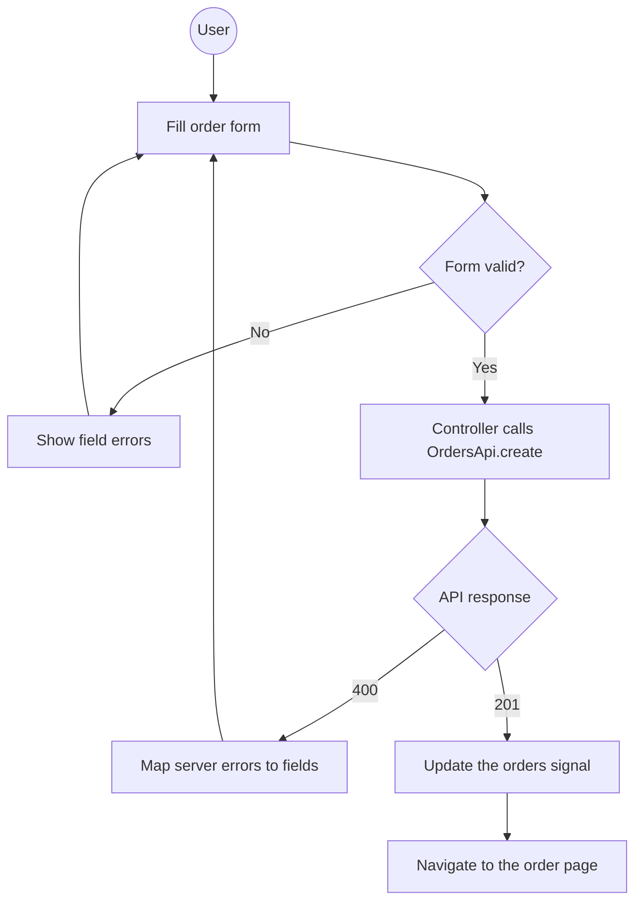

---

## 2. Sequence Diagram — Authentication Flow

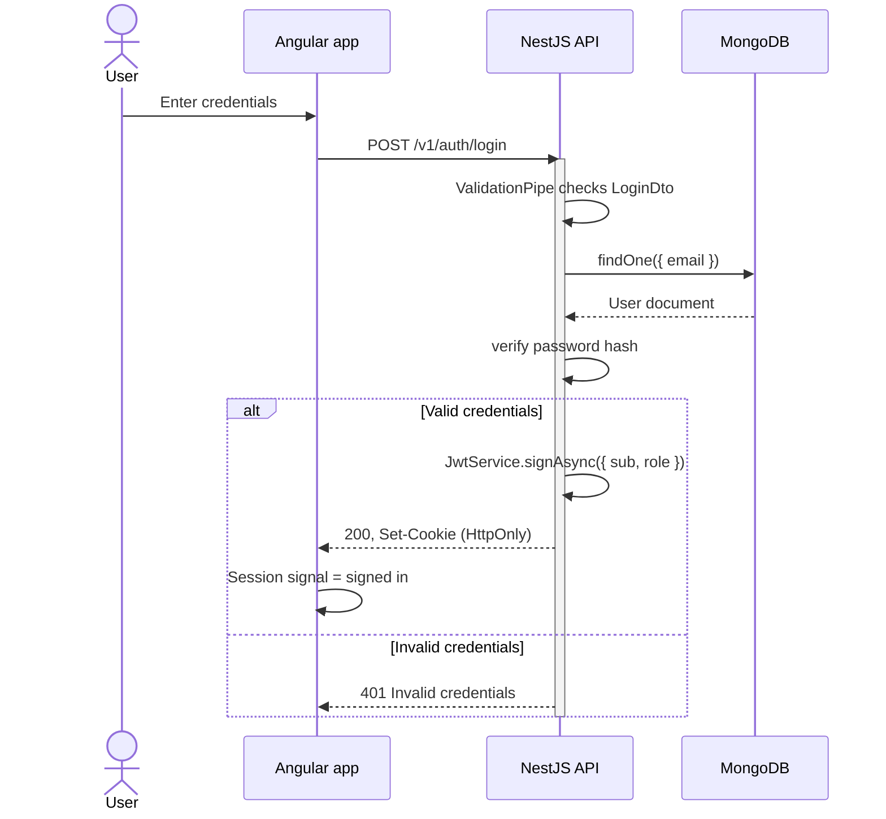

---

## 3. Sequence Diagram — NestJS Request Pipeline

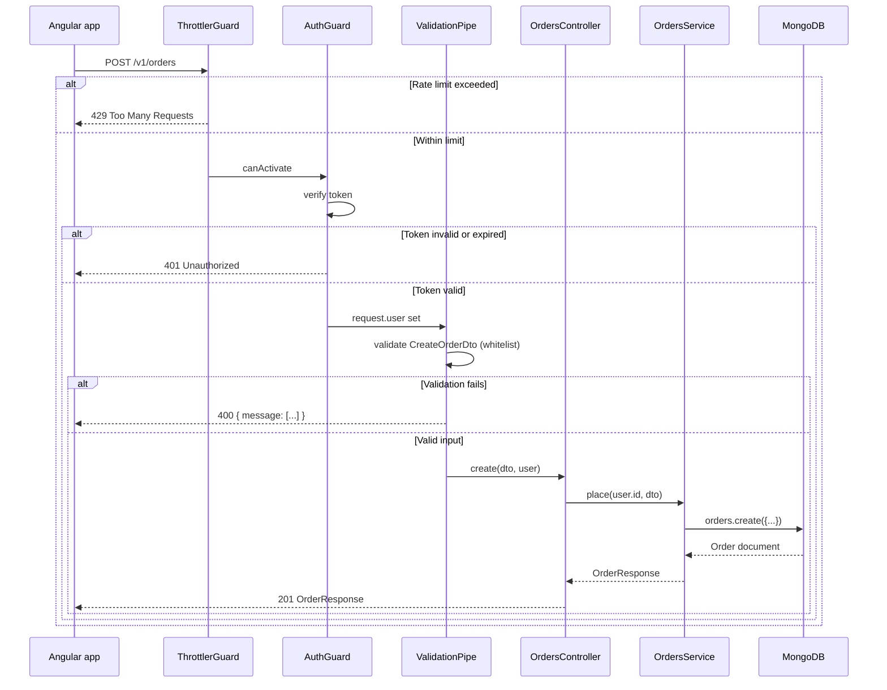

---

## 4. ER Diagram — Orders Schema

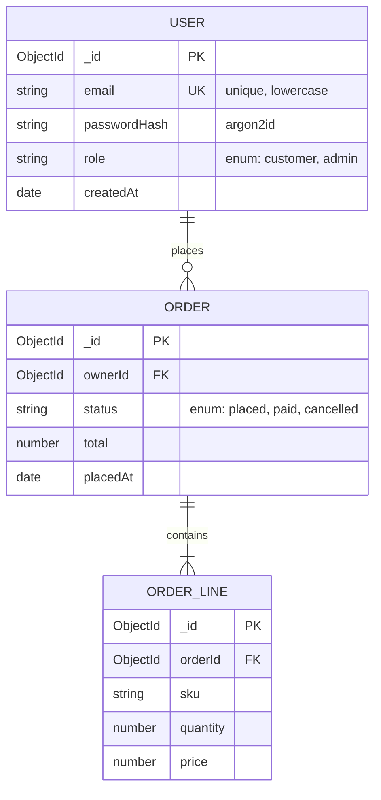

---

## 5. State Diagram — Order Lifecycle

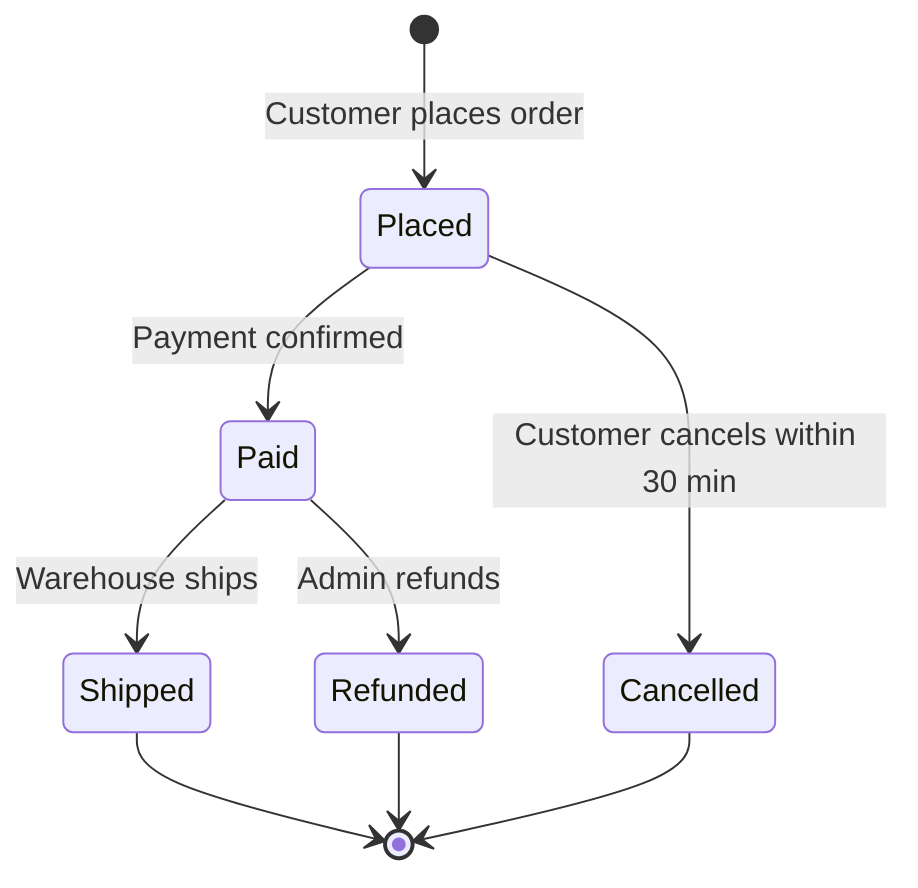

---

## 6. Flowchart — File Upload Pipeline

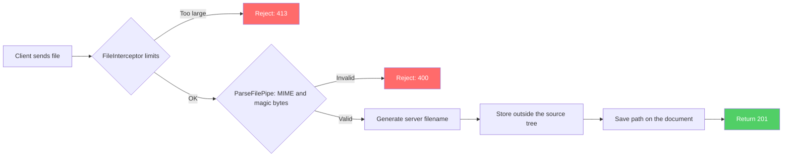

---

## 7. Flowchart — Error Handling in NestJS

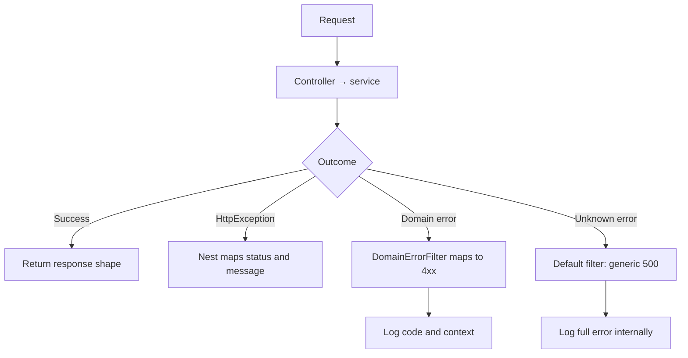

---

## 8. Class Diagram — Frontend MVP Roles

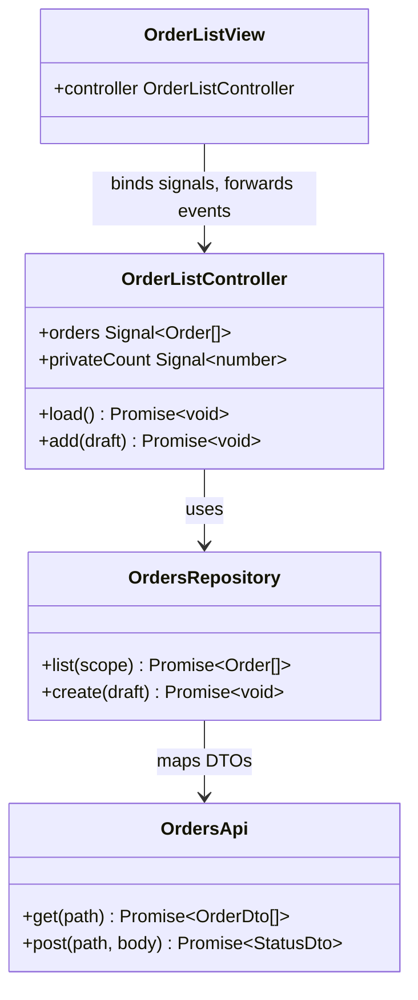

---

## 9. Flowchart — CORS Request Flow

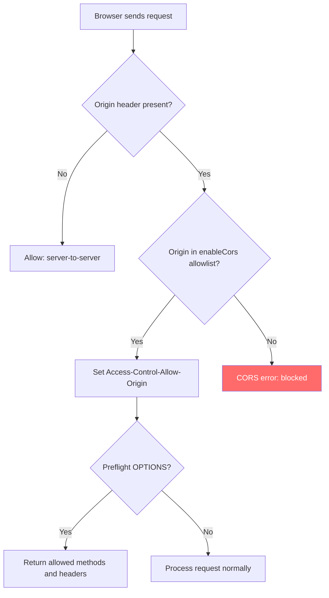

---

## 10. Gantt Chart — Feature Implementation Plan

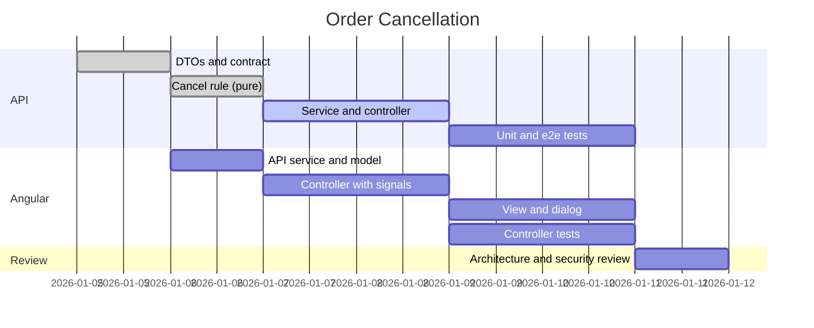

---

## 11. Mindmap — Project Architecture

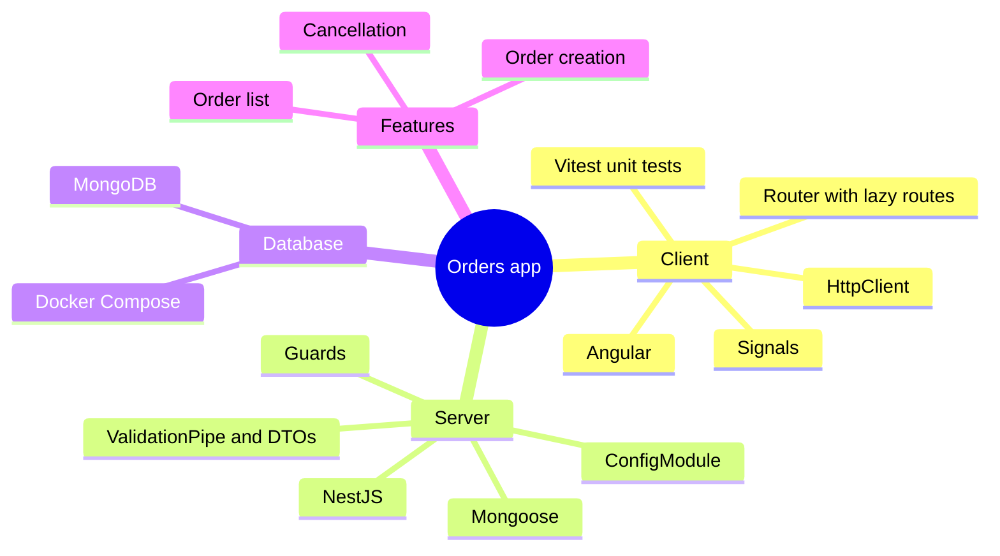

---

## 12. Pie Chart — OWASP Vulnerability Distribution

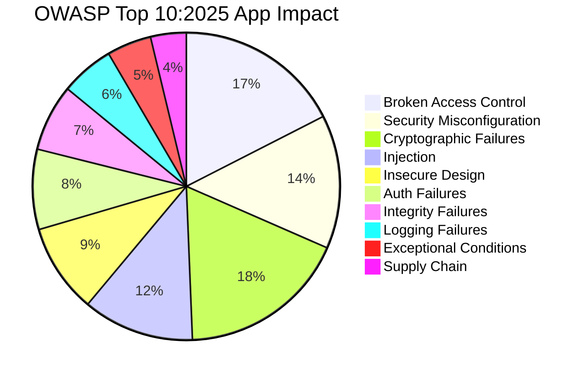
