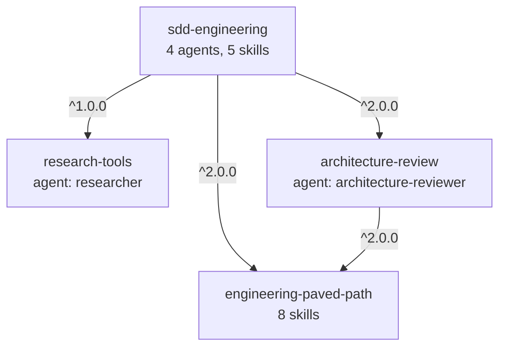
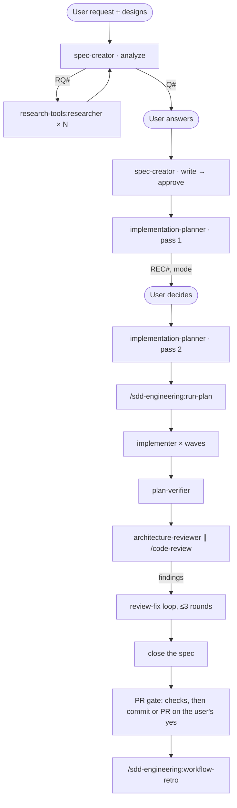

# SDD engineering plugins

| | |
|---|---|
| Status | Implemented on branch `sdd-engineering`; release validation pending (see *Validation before release*) |
| Date | 2026-10-14 |
| Source | `sgdiachenko/dev-digest` at `1b694bc41a61` (`.claude/agents/`, `.claude/skills/`, `evals/`) |
| Plugins | `sdd-engineering`, `engineering-paved-path`, `research-tools`, `architecture-review` |
| In this repository | Released as 2.0.0 for Angular + NestJS in `gm-ai-marketplace-angular-nestjs` (2026-10-27). The workflow below is unchanged; the stack skills changed. Tables and rules name the 2.0.0 skills; *Provenance* keeps the 1.x history. |

## Summary

Package the team's Spec-Driven Development (SDD) workflow as four plugins. `sdd-engineering` holds the workflow: the agents that write a spec, plan it, implement it and verify it, plus the skills that run an approved plan and review a finished run. Three reusable plugins are its dependencies: shared engineering skills, a research agent and an architecture reviewer. One install command gives a project the whole chain `spec → plan → implement → verify → review`.

## Problem

- The workflow lives in one application repository, `dev-digest`, and its agents name that repository's directories, commands and files (`server/`, `pnpm -C server …`, `gate.sh`, `routing.md`). No other project can use it without rewriting it.
- Skills that several agents need (architecture, insights, security) are copied per repository, so improvements don't travel.
- There are no versions: nobody can say which workflow a project runs or roll a bad change back.

## Goals

1. Install the full workflow into any project with one command; dependencies come with it.
2. No agent or skill names a specific project. Everything project-bound comes from explicit inputs.
3. Reusable parts ship as their own plugins, so a project can take only the researcher or only the architecture reviewer.
4. Every plugin has a README that explains how to work with it, and a CHANGELOG that lists its releases.
5. Dependencies are declared and checked: a plugin that uses another plugin's skill or agent declares it, and CI fails otherwise.

## Non-goals

- dev-digest product content: its specs, plans, retros and app-specific reviewer prompts.
- Secrets and caches: `~/.devdigest/secrets.json`, `evals/results`, token logs.
- DevDigest-specific instructions: package names, migrations, its hermetic-test setup, its browser-automation notes.
- Agents outside the slide set: `brainstorm`, `test-writer`, `doc-writer`, `security-reviewer`, `stack-reviewer`, `conventions-reviewer`.
- `pr-self-review` and its `PreToolUse` gate hook.
- The other eight dev-digest stack skills (`zod`, `typescript-expert`, `drizzle-orm-patterns`, `postgresql-table-design`, `breaking-change`, `response-schema`, `deprecation-policy`, `semver-discipline`). Each can join `engineering-paved-path` later as a minor release.
- A Codex port. The value of `sdd-engineering` is in agents, so it stays Claude-only (`docs/codex-compatibility.md`, rule 5). `engineering-paved-path` follows the skill rules and stays portable.

## Plugins and dependencies

| Plugin | Version | Components | Depends on |
|---|---|---|---|
| `engineering-paved-path` | 2.0.0 | skills: `angular-developer`, `nestjs-best-practices`, `frontend-architecture`, `nestjs-backend-architecture`, `security`, `engineering-insights` | none |
| `research-tools` | 1.0.0 | agent: `researcher` | none |
| `architecture-review` | 2.0.0 | agent: `architecture-reviewer` | `engineering-paved-path ^2.0.0` |
| `sdd-engineering` | 1.0.0 | agents: `spec-creator`, `implementation-planner`, `implementer`, `plan-verifier`; skills: `run-plan`, `workflow-retro`, `ears-requirements`, `ux-design-review`, `mermaid-diagram` | `engineering-paved-path ^2.0.0`, `research-tools ^1.0.0`, `architecture-review ^2.0.0` |

- All four start at `1.0.0`, an exception to the `0.1.0` start in `docs/adding-a-plugin.md`: they are ports of a workflow in daily use, and `^1.0.0` must match.
- Dependencies are objects in `plugin.json`: `{ "name": "engineering-paved-path", "version": "^1.0.0" }`. All of them live in this marketplace, so no cross-marketplace allowlist is needed.
- **Direct declaration rule.** A plugin that names another plugin's component (`<plugin>:<component>`) declares that plugin in its own `dependencies`. Reaching it through another dependency doesn't count: `sdd-engineering` declares `engineering-paved-path` even though `architecture-review` already pulls it in.

### Who uses what

`paved:` stands for `engineering-paved-path:`.

| Component | Preloads (`skills:`) | Calls or loads on demand |
|---|---|---|
| `sdd-engineering:spec-creator` | `sdd-engineering:ears-requirements`, `sdd-engineering:ux-design-review`, `sdd-engineering:mermaid-diagram`, `paved:security`, `paved:engineering-insights` | asks the main session to run `research-tools:researcher` for each `RQ#` |
| `sdd-engineering:implementation-planner` | `paved:engineering-insights` | lane skills from the project profile, through the Skill tool |
| `sdd-engineering:implementer` | `paved:engineering-insights` | the skills each plan step names, through the Skill tool |
| `sdd-engineering:plan-verifier` | `sdd-engineering:ears-requirements`, `paved:engineering-insights` | the skill each plan constraint cites as its `source:` |
| `/sdd-engineering:run-plan` | — | `sdd-engineering:implementer`, `sdd-engineering:plan-verifier`, `architecture-review:architecture-reviewer`, built-in `/code-review` and `/security-review` |
| `/sdd-engineering:workflow-retro` | — | `sdd-engineering:mermaid-diagram`, `paved:engineering-insights`, its own `assets/collect.mjs` |
| `architecture-review:architecture-reviewer` | `paved:nestjs-backend-architecture`, `paved:frontend-architecture`, `paved:engineering-insights` | `paved:nestjs-best-practices`, `paved:angular-developer` |
| `research-tools:researcher` | — | — |

### Where a skill goes

- A skill used by more than one plugin, or describing a stack practice, goes to `engineering-paved-path`.
- A skill with a single consumer ships inside that consumer.
- Result: `engineering-insights` (5 consumers in 2 plugins) and the architecture, framework (Next.js in 1.x, Angular and NestJS in 2.0.0) and security skills (used by both `architecture-review` and `sdd-engineering`) go to the paved path; `ears-requirements`, `ux-design-review` and `mermaid-diagram` stay in `sdd-engineering`.

## Packaging rules

Every ported agent, skill and supporting file follows these rules.

1. **No project-bound content.** No DevDigest name or URL; no `server/`, `client/`, `reviewer-core/`, `mcp-server/`, `e2e/`; no `pnpm -C …`, `gate.sh`, `routing.md`, `~/.devdigest`; no dev-digest file names, rule names, dates or "user decision" notes. Values a project must supply come from the project profile; examples use neutral paths such as `src/domain/` or `apps/web/`.
2. **Skills by namespace.** Agent `skills:` lists use namespaced names (`engineering-paved-path:nestjs-backend-architecture`). On-demand skills load through the Skill tool by the same name, which replaces reading `.claude/skills/<name>/SKILL.md`. Agents that load skills on demand therefore have `Skill` in `tools`.
3. **Agents by namespace.** `research-tools:researcher`, `architecture-review:architecture-reviewer`, `sdd-engineering:implementer`.
4. **Bundled files through `${CLAUDE_SKILL_DIR}`.** Scripts a skill runs are called as `node "${CLAUDE_SKILL_DIR}/assets/collect.mjs"`, never through `.claude/skills/`.
5. **User state in `${CLAUDE_PLUGIN_DATA}`.** The retro's rate card is read from `${CLAUDE_PLUGIN_DATA}/prices.json` first, then from the bundled, empty `assets/prices.json`.
6. **`permissionMode` is ignored in plugin agents.** Read-only agents are read-only through `tools` and `disallowedTools`. The implementer no longer runs in `acceptEdits`; the README tells users to approve edits or start the session in that mode.
7. **Short descriptions.** Each skill and agent `description` stays under about 350 characters, since it loads into every session. Frontmatter is English.
8. **Language.** Everything in the plugins is English: agent and skill bodies, examples, comments and scripts. What agents write into a user's project (specs, plans, retros) follows the profile's docs language, English by default. EARS keywords are `WHEN`, `WHILE`, `IF … THEN` and `WHERE`, with `shall`; a profile may list translated keywords for specs written in another language.

## Project profile

The explicit inputs that replace dev-digest paths. A Markdown file in the user's project, `docs/sdd-profile.md` by default; a `Profile:` line in an agent prompt points elsewhere. `sdd-engineering` ships a template as `skills/run-plan/profile-template.md`.

| Section | Holds | Default when missing |
|---|---|---|
| Paths | specs, plans, retros, design images | `docs/specs/`, `docs/plans/`, `docs/retros/`, `docs/design/` |
| Language | docs language, EARS keywords | English; `WHEN` / `WHILE` / `IF … THEN` / `WHERE` |
| Modules | name, path, full check commands, targeted test command | none: agents ask instead of guessing |
| Skill lanes | file glob → namespaced skills | none: agents use the paved-path skills that match the file type |
| Architecture rules | rule sources (skills, config files, ADRs), mechanical check commands | `engineering-paved-path:nestjs-backend-architecture` and `:frontend-architecture` |
| Guardrails | extra forbidden commands, do-not-touch paths | the built-in list: commits, push, PRs, installs, migrations, destructive container commands |
| Live checks | whether manual verification may call paid or credentialed services | no |

- Agents never guess a check command. Without one they return `blocked` or a question.
- `run-plan` checks the profile in its intake phase and, when it's missing, offers to draft one from the repository (`AGENTS.md`, `CLAUDE.md`, package scripts, CI config) for the user to approve.

## Components

| Component | Model | Tools | Writes | Changes from dev-digest |
|---|---|---|---|---|
| `spec-creator` | opus | Read, Grep, Glob, Bash, Write, Edit | `<specs>/<YYYY-MM-DD>-<slug>.md`, `<specs>/README.md` | modules from the profile; on-demand contract skills dropped |
| `implementation-planner` | opus | Read, Grep, Glob, Bash, Skill | nothing | preloads one skill instead of 16 (~40k tokens); lanes from the profile |
| `implementer` | sonnet | Read, Edit, Write, Grep, Glob, Bash, Skill | the code its plan steps name | checks and guardrails from the profile |
| `plan-verifier` | sonnet | Read, Grep, Glob, Bash, Write, Skill | `<plans>/<slug>.verification.md` | bundled `fingerprint.sh` replaces `gate.sh fingerprint` |
| `researcher` | sonnet | Read, Grep, Glob, Bash, WebSearch, WebFetch | nothing | none beyond removing project names |
| `architecture-reviewer` | sonnet | Read, Grep, Glob, Bash, Skill | nothing | rules from the profile first, paved-path skills as the default; finding schema inlined |
| `run-plan` | main session | — | `<plans>/<slug>.impl.md`, `.reports.md`, `.brief.md` | review = `architecture-reviewer` ∥ `/code-review` (+ `/security-review` when flagged); the `doc-writer` phase becomes "close the spec"; the PR gate runs the profile checks |
| `workflow-retro` | main session | — | `<retros>/<YYYY-MM-DD>-<slug>.md`, `<retros>/ledger.md` | transcripts found through `CLAUDE_CONFIG_DIR`; rate card in plugin data |

## Flow

The main session orchestrates: subagents can't ask the user questions, so each returns numbered questions and the main session asks them.

| Step | Writes |
|---|---|
| spec-creator | `<specs>/<YYYY-MM-DD>-<slug>.md`, a row in `<specs>/README.md` |
| implementation-planner | nothing; the main session saves the approved plan to `<plans>/<slug>.md` |
| run-plan | `<plans>/<slug>.impl.md` (state), `.brief.md`, `.reports.md` |
| plan-verifier | `<plans>/<slug>.verification.md` |
| close the spec | `Status: implemented` and an `## Implementation` section in the spec |
| workflow-retro | `<retros>/<YYYY-MM-DD>-<slug>.md`, a row in `<retros>/ledger.md` |

## READMEs and CHANGELOGs

- Every plugin ships a README in English. It covers what the plugin is for, how to install it, each component and how to call it (`/plugin:skill`, `plugin:agent`), configuration, examples and limits, and it links the CHANGELOG.
- The `sdd-engineering` README is the workflow guide: the flow diagram, the components, the artifacts, the profile, how to start each step, permissions and cost.
- Every plugin ships `CHANGELOG.md`: one `## <version> — <YYYY-MM-DD>` heading per release with `Added`, `Changed`, `Removed` or `Fixed` lists.
- `scripts/check-marketplace.mjs` checks that a plugin's CHANGELOG is English and has a heading for the version in `plugin.json`.
- `scripts/check-pr.mjs` exempts CHANGELOG-only changes from the version bump, as it does for README-only changes.

## Release

- **Catalog.** Four entries in `.claude-plugin/marketplace.json`, without `version`.
- **Tags.** A version range resolves against git tags named `<plugin>--v<version>` in the repository that hosts the plugin, here this marketplace. Without a matching tag Claude Code installs the catalog's current copy and checks the range when the plugin loads. `.github/workflows/tag-releases.yml` runs `scripts/tag-releases.mjs` on every push to `main` and creates the missing tag for each plugin's current version.
- **Order.** Dependencies are released before their dependents. With one PR per plugin: tooling and docs, then `engineering-paved-path`, `research-tools`, `architecture-review`, and `sdd-engineering` last.
- **Checks added to `scripts/check-marketplace.mjs`:**
  - every `dependencies` entry names a plugin in this catalog, and that plugin's current version satisfies the range;
  - every `<plugin>:<component>` reference in a plugin names the plugin itself or a direct dependency, and the component exists;
  - every `${CLAUDE_SKILL_DIR}/<path>` exists in the skill's folder;
  - no file under `plugins/` mentions `dev-digest`, `devdigest`, `.claude/skills/` or `.claude/agents/`;
  - `evals/` is maintainer-only and never sits inside a plugin.

## Evals

- **Format.** The built-in `claude plugin eval`. Cases live at the repository root in `evals/<suite>/<case>/`, outside `plugins/`, name the plugins they load with `plugins:`, and carry their suite as a tag. Suites run with the repository root as the target (`claude plugin eval . --tag <suite>`): the command loads `plugins:` entries only from under the directory it runs against.
- **Suites:**
  - `namespaces`: free `tool_used` graders confirm that `engineering-paved-path:<skill>`, `research-tools:researcher`, `architecture-review:architecture-reviewer` and the `sdd-engineering` agents are reachable by their namespaced names;
  - `architecture-review`: the three dev-digest fixtures, generalized: a clean refactor with no findings, a layer violation, a core-boundary violation;
  - `sdd-engineering`: `spec-creator` in analyze mode writes nothing and returns questions; `run-plan` stops without a plan.
- **When.** Run by hand before a release with `scripts/run-evals.sh <suite>`, which passes `--ablation none` (namespaced agents don't exist in a no-plugin baseline), `--no-publish` (reports otherwise go to claude.ai) and a cost ceiling. CI doesn't run them: it has no model credentials, and the runs cost money.

## Licensing

The repository is public.

- (1.x, removed in 2.0.0) `fastify-best-practices` is Matteo Collina's MIT-licensed skill (`mcollina/skills` at `72b7275`), with only the description shortened. The dev-digest copy was older, so the plugin ships the upstream version. Its folder carries `LICENSE` and a `NOTICE.md`.
- (1.x, removed in 2.0.0) `next-best-practices` came from `vercel-labs/next-skills`, which publishes no license and has withdrawn the skill. The paved path ships a new, shorter skill under the same name, written for this marketplace, that defers to the Next.js docs bundled with the installed version.
- The other skills and the agents come from the author's own `dev-digest`.
- `docs/plugins/engineering-paved-path.md` records the origin of each skill.

## Validation before release

1. `scripts/validate.sh`: strict validation of the catalog and every plugin, repository conventions with the new checks, shellcheck.
2. Load the four plugins locally with `claude --plugin-dir` and check with `claude plugin details <name>` that each component loads under its namespace; record the context cost in `docs/plugins/<name>.md`.
3. Run the chain `spec → plan → implement → verify → review` on a small fixture project.
4. Run the `namespaces` eval suite.
5. Push the branch and run `scripts/try-install.sh sdd-engineering`: the three dependencies install with it. After the merge, check that the four tags exist.

## Risks and open questions

- Whether an agent's `skills:` list preloads a namespaced skill from a dependency plugin is not documented. If it doesn't, agents load those skills through the Skill tool instead.
- Resolved: `claude plugin eval` runs cases outside a plugin directory when the target is a directory that contains both the cases and the plugins (the repository root). A case file as the target fails: its `plugins:` entries resolve outside the case directory, the containment root.
- `claude plugin eval` may be in early access for some accounts.
- (1.x) `react-best-practices`, `react-testing-library`, `security` and `mermaid-diagram` have no public upstream that a code search on 2026-10-14 could find. They are treated as the author's own.
